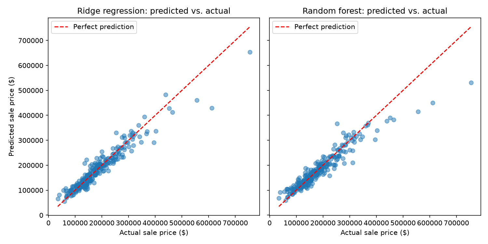
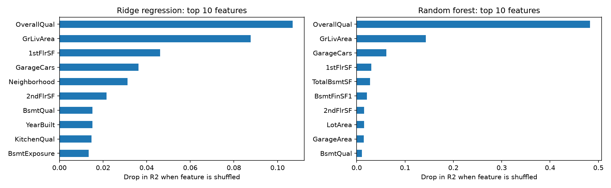

# House Price Prediction (Ames, Iowa)

Predicting home sale prices from property features using Python and scikit-learn,
and comparing two models against a simple baseline.

## Data

[House Prices - Advanced Regression Techniques](https://www.kaggle.com/c/house-prices-advanced-regression-techniques) on Kaggle:
1,460 homes in Ames, Iowa with 79 features. The data file is not included in this repo;
download `train.csv` from Kaggle and place it in this folder.

## Question

How accurately can a home's sale price be predicted from its features, and which features matter most?

## Approach

1. **Cleaning:** dropped columns with more than 50% missing values (`[list them, e.g. PoolQC, Alley]`), filled remaining numeric gaps with the median and categorical gaps with "Missing".
2. **Preprocessing:** scaled numeric features, one-hot encoded categorical features, and trained on log(price) because prices are right-skewed.
3. **Models:** a baseline (always predict the average price), Ridge regression, and a random forest.
4. **Evaluation:** 80/20 train/test split; error measured in dollars (MAE, RMSE) and R².

## Results

| Model | MAE ($) | RMSE ($) | R² |
| --- | --- | --- | --- |
| Baseline (average price) | 59,931 | 88,271 | -0.016 |
| **Ridge regression** | **16,500** | **25,142** | **0.918** |
| Random forest | 17,188 | 29,265 | 0.888 |

The best model (Ridge regression) predicted sale prices within about $16,500 on average, explaining about 92% of the variation in price.

Charts below are for the random forest model.

## Key Findings

- The most important features were [feature 1], [feature 2], and [feature 3].
- Both models were far better than the baseline: Ridge cut the average error from about $59,900 to about $16,500 (roughly 72% lower).
- The simpler Ridge regression slightly outperformed the random forest. The random forest used mostly default settings, so tuning it might close the gap.
- The data covers a single city (Ames, Iowa) and about 1,460 homes, so the models may not generalize to other markets.

## What I'd try next

- [e.g. add a total square footage feature, tune the random forest, try gradient boosting]

## How to Run

1. Download `train.csv` from the Kaggle link above into this folder.
2. `pip install -r requirements.txt`
3. `python predict_price.py train.csv`
